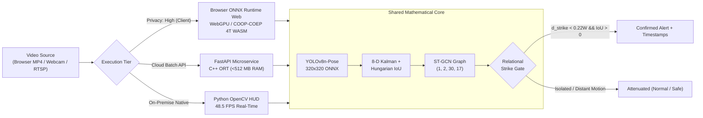

<div align="center">

# ⚡ Edge Vision

**Real-time, privacy-preserving skeleton violence detection powered by YOLOv8n-Pose, 8-D Kalman Tracking, and ST-GCN across 512 MB Cloud &amp; Multi-Threaded Browser WebAssembly.**

<p>
  <a href="https://nextjs.org/"></a>
  <a href="https://onnxruntime.ai/"></a>
  <a href="https://webassembly.org/"></a>
  <a href="https://pytorch.org/"></a>
  <a href="https://fastapi.tiangolo.com/"></a>
  <a href="https://opencv.org/"></a>
</p>

<h3>
  📄 <a href="./paper/Edge_Vision_Paper.pdf">Read the Official IEEE Research Paper (PDF)</a>
</h3>

<p>
  <code>Accuracy: 82.94%</code> &nbsp;•&nbsp;
  <code>F1 Score: 0.854</code> &nbsp;•&nbsp;
  <code>Recall: 97.33%</code> &nbsp;•&nbsp;
  <code>Precision: 76.04%</code> &nbsp;•&nbsp;
  <code>Throughput: 48.5 FPS</code>
</p>

<p>
  <a href="#-architecture-overview">Architecture</a> •
  <a href="#-visual-showcase">Showcase</a> •
  <a href="#-benchmarks--deep-dives">Benchmarks</a> •
  <a href="#-benchmarks--deep-dives">Local Setup</a> •
  <a href="./paper/paper.tex">LaTeX Source</a>
</p>

</div>

---

## 🧩 Core Engineering Pillars

<table>
  <tr>
    <td width="50%" valign="top">
      <h3>🧬 1. ST-GCN &amp; Skeletal Kinematics</h3>
      <p>
        Discards dense <code>1920×1080×3</code> pixel volumes immediately after pose estimation in favor of compact 17-node COCO topological graphs—achieving a <b>99.8% data reduction</b> while decoupling motion from lighting, clothing, and background clutter.
      </p>
      <ul>
        <li><b>YOLOv8n-Pose (<code>320×320</code> ONNX):</b> Letterboxed RGBA/RGB NCHW extraction with NMS (<code>0.45</code>).</li>
        <li><b>Mid-Hip &amp; Torso Scaling:</b> Preserves missing joints strictly at <code>[0.0, 0.0]</code> via explicit validity masking.</li>
        <li><b>ST-GCN Topology:</b> Symmetric normalized adjacency across <code>2→16→32→64</code> residual spatial-temporal blocks over <code>T=30</code> frames (single <code>257 KB</code> self-contained ONNX binary).</li>
      </ul>
    </td>
    <td width="50%" valign="top">
      <h3>🎯 2. Multi-Agent Kalman Tracking</h3>
      <p>
        Physical altercations cause heavy mutual occlusion during clinches, tackles, and grappling. Naive greedy centroid trackers swap identities and corrupt pose velocity derivatives.
      </p>
      <ul>
        <li><b>8-D State Vector:</b> Tracks <code>[cx, cy, w, h, vx, vy, vw, vh]</code> per subject under a constant-velocity motion prior.</li>
        <li><b>Hungarian Bipartite Assignment:</b> Solves optimal global matching via an IoU cost matrix (<code>1 - IoU</code>).</li>
        <li><b>Occlusion Persistence:</b> Retires unmatched tracks after <code>max_age = 10</code> frames; qualitative observation during validation indicates the 8-D state vector preserves track identities through transient occlusions, reducing ID switches compared to greedy IoU matching.</li>
      </ul>
    </td>
  </tr>
  <tr>
    <td width="50%" valign="top">
      <h3>🛡️ 3. Relational Strike Gating</h3>
      <p>
        Raw action classifiers frequently misfire on energetic solo gestures such as waving, dancing, or jumping. Deterministic geometric invariants suppress isolated false alarms before alerts latch.
      </p>
      <ul>
        <li><b>Effector-to-Target Bounds:</b> Evaluates Euclidean proximity from attacker wrists/ankles (<code>9, 10, 15, 16</code>) to opponent torso/head joints (<code>0–12</code>) and bounding boxes.</li>
        <li><b>Convergence Guardrail:</b> Attenuates triggers (<code>p → 0.25</code>) unless <code>d_strike &lt; 0.22·W</code> and inter-actor bounding boxes intersect (<code>IoU &gt; 0.0</code>).</li>
        <li><b>Context Hysteresis:</b> Optional 1 FPS MobileNetV3 scene gate elevates threshold to <code>0.85</code> in sports/gym arenas.</li>
      </ul>
    </td>
    <td width="50%" valign="top">
      <h3>⚡ 4. 512 MB Cloud vs. Multi-Core WASM Edge</h3>
      <p>
        Partitioned dual-tier deployment serving both ultra-lean cloud containers and zero-upload client browsers from one canonical set of ONNX weights.
      </p>
      <ul>
        <li><b>Cloud Mode (FastAPI / Render):</b> Excludes PyTorch (<code>HAS_TORCH=False</code>), caps ONNX threads (<code>intra_op=1</code>), enforces container magic-byte checks and IP rate limits within 512 MB RAM.</li>
        <li><b>Edge WASM Mode (Next.js 16):</b> Executes locally via <code>onnxruntime-web</code> (<code>WebGPU → WASM SIMD</code>) unlocked by server-injected <code>COOP/COEP</code> headers enabling <code>SharedArrayBuffer</code> multi-threading.</li>
      </ul>
    </td>
  </tr>
</table>

---

## 🏗️ Architecture Overview



---

## 📸 Visual Showcase

<table>
  <tr>
    <td width="50%" align="center" valign="top">
      
      <br />
      <sub><b>Next.js 16 Diagnostics Console</b> — Cloud API &amp; local WebGPU/WASM execution with clickable incident scrubbing.</sub>
    </td>
    <td width="50%" align="center" valign="top">
      
      <br />
      <sub><b>Native OpenCV Edge HUD (50+ FPS)</b> — Live COCO-17 skeletons, Kalman track IDs, and strike proximity vectors.</sub>
    </td>
  </tr>
</table>

---

## 🔬 Benchmarks &amp; Deep Dives

<details>
<summary><b>📊 Chronologically Partitioned Evaluation, Unbundled Ablation Study &amp; Confusion Matrix (293 Held-Out Test Videos)</b></summary>
<br />

Evaluated on **1,951 verified clips** from the *Real Life Violence Situations* corpus partitioned by source-video ID via a frozen chronological **70/15/15 split** ([`backend/data/splits_manifest.json`](backend/data/splits_manifest.json)) to prevent source-level data leakage:
- **Training Split (70%):** `1,365` videos
- **Validation Split (15%):** `293` videos (all thresholds &amp; Relational Strike Gate bounds tuned exclusively here)
- **Held-Out Test Split (15%):** `293` unseen videos (`45,754` frames; `150` Violent, `143` Non-Violent, `Train ∩ Test = ∅`)

| Architecture Configuration | Precision | Recall | Specificity | F1 Score | False Positives |
| :--- | :---: | :---: | :---: | :---: | :---: |
| Baseline ST-GCN (Raw Pose Graph) | 69.86% | 97.33% | 55.94% | 0.813 | 63 / 143 (44.1%) |
| ST-GCN + 8-D Kalman Tracking (only) | 69.19% | 97.33% | 54.55% | 0.809 | 65 / 143 (45.5%) |
| ST-GCN + Naive Centroid Gate (`d <= 0.22W`) | 69.86% | 97.33% | 55.94% | 0.813 | 63 / 143 (44.1%) |
| ST-GCN + Relational Strike Gate (only) | 70.19% | 97.33% | 56.64% | 0.816 | 62 / 143 (43.4%) |
| ST-GCN + Tracking + Naive Centroid Gate | 71.22% | 97.33% | 58.74% | 0.823 | 59 / 143 (41.3%) |
| ST-GCN + Tracking + Strike Gate (Cloud Config) | 70.53% | 97.33% | 57.34% | 0.818 | 61 / 143 (42.7%) |
| **Full System (+ MobileNetV3 Scene Gating)** | **76.04%** | **97.33%** | **67.83%** | **0.854** | **46 / 143 (32.2%)** |

```text
CONFUSION MATRIX (Held-Out Test Set — 293 Videos / 45,754 Frames):
                       Predicted Safe    Predicted Violence      Total
  Actual Safe (NV)             97                  46              143
  Actual Violence (V)           4                 146              150
  Total                       101                 192              293

Accuracy: 82.94% | Precision: 76.04% | Recall: 97.33% | Specificity: 67.83% | F1 Score: 0.854
```

> **Operational Notes:**
> - **Privacy Posture:** Client-side **Edge Mode** guarantees strict zero-upload video privacy (video stays inside local browser WASM/WebGPU or local OpenCV); **Cloud Mode** operates as a standard FastAPI REST API (`POST /api/analyze_video`) receiving uploaded video payloads for server-side inference.
> - **Dual-Invariant Strike Gate vs. Naive Centroid:** Requiring both effector-to-target reach (`d_strike <= 0.22*W`) and box overlap (`IoU > 0`) protects against centroid drift under heavy occlusion and wide-limb kicks/punches where body centers stay apart.
> - **Scene Gating Trade-Off:** MobileNetV3 scene classification raises thresholds (`0.85`) in detected gym/sports settings to drop FPs (`61 -> 46`); disable (`enable_scene_gating=False`) when monitoring high-security athletic venues.

</details>

<details>
<summary><b>⚡ Hardware Latency Variance &amp; End-to-End Throughput (48.5 FPS CPU)</b></summary>
<br />

Measured on an **11th Gen Intel Core i5-1135G7 @ 2.40 GHz CPU (4 cores / 8 threads)** over **100 timed iterations (after 10 warm-up iterations)** on `violence_sample.mp4`, explicitly including OpenCV `cv2.VideoCapture.read()` decode &amp; YOLOv8n-Pose extraction:

| Pipeline Stage / Profile | Mean ± Std Dev | Rate / Notes |
| :--- | :---: | :--- |
| OpenCV Video Decode (`cap.read`) | 6.38 ± 8.35 ms | H.264 / MP4 frame I/O |
| YOLOv8n-Pose (`320×320` ONNX, 4T) | 29.17 ± 6.25 ms | Keypoint &amp; bbox regression + NMS |
| Kalman Occlusion Tracker | 0.44 ± 0.13 ms | Analytic block covariance + Hungarian |
| Torso Normalization &amp; Graph Prep | 2.09 ± 0.43 ms | Mid-hip centering &amp; `[0,0]` masking |
| ST-GCN Temporal Conv (ONNX) | 0.91 ± 0.59 ms | `30×17` graph convolution (`257 KB`) |
| Relational Strike Gate | 0.62 ± 0.17 ms | Effector-to-target distance + IoU |
| End-to-End (Stride-1, 4T w/ Decode) | 39.63 ± 10.78 ms | **25.2 FPS** (every frame decoded) |
| End-to-End (Stride-2, 1T Cloud w/ Decode) | 22.26 ± 14.54 ms | **44.9 FPS** (single-threaded CPU) |
| **End-to-End (Stride-2, 4T w/ Decode)** | **20.63 ± 13.49 ms** | **48.5 FPS** (`14.81 ± 13.19 ms` process-only) |

Automated continuous-stream regression (`python backend/benchmark_tests.py` concatenating `NV_1.mp4` + `V_1.mp4`): **0 / 66 (0.0%) false alarms**, **1.0000 precision**, while Node.js `onnxruntime-web` WASM parity confirms `peak=0.727` (`Violence`) and `peak=0.217` (`Safe`).

</details>

<details>
<summary><b>🛠️ Local Setup, Live Camera CLI, Web Dashboard &amp; Docker Deployment</b></summary>
<br />

#### 1. Native Python Setup (Live Webcam / RTSP / Benchmarks)
```bash
git clone https://github.com/Parth-Aish/Violence-Detection-Edge.git
cd Violence-Detection-Edge
pip install -r requirements.txt

# Real-time webcam surveillance HUD (~50 FPS)
python backend/run_live.py --source 0

# Run FastAPI cloud microservice + static frontend on port 8000
uvicorn --app-dir backend main:app --host 0.0.0.0 --port 8000

# Run automated concatenated stream benchmark suite
python backend/benchmark_tests.py
```

#### 2. Frontend Next.js 16 Development Server
```bash
cd frontend
npm install
npm run dev   # Proxies /api/* to localhost:8000 with COOP/COEP headers enabled
```

#### 3. Production Container Build (Render / Docker)
```bash
docker build -t edge-vision .
docker run -p 10000:10000 edge-vision
```

> **Pro-Tip for Long-Form Videos:** For videos longer than 30 seconds in the web UI, toggle **Edge WASM (Privacy: High)** to analyze locally via multi-threaded WebAssembly/WebGPU with zero network upload overhead.

</details>

<details>
<summary><b>🗂️ Repository Structure</b></summary>
<br />

```text
Violence-Detection-Edge/
├── assets/
│   ├── dashboard_preview.png              # Web UI showcase
│   └── edge_hud_preview.png               # Native OpenCV HUD showcase
├── backend/
│   ├── core/
│   │   ├── graph.py                       # COCO-17 skeletal adjacency matrix
│   │   ├── inference.py                   # PoseSTGCNDetector + Relational Strike Gate
│   │   ├── model.py                       # Residual ST-GCN PyTorch architecture
│   │   ├── scene_gating.py                # MobileNetV3 athletic context classifier
│   │   ├── tracking.py                    # 8-D KalmanBoxTracker & Hungarian matching
│   │   └── transforms.py                  # Mid-hip normalization & [0,0] joint masking
│   ├── data/
│   │   ├── evaluation_report.json         # Evaluation output artifacts
│   │   ├── splits_manifest.json           # Frozen 70/15/15 split (1,951 videos)
│   │   └── video_ids.json                 # Source-ID manifest for training
│   ├── benchmark_tests.py                 # Concatenated accuracy & FPS regression suite
│   ├── evaluate_all.py                    # Held-out & full dataset evaluator
│   ├── logger.py                          # Thread-safe SQLite + JSONL incident logger
│   ├── main.py                            # FastAPI service + COOP/COEP middleware
│   ├── prepare_dataset.py                 # Dataset keypoint extraction pipeline
│   ├── run_live.py                        # Live RTSP / webcam OpenCV HUD runner
│   └── train_stgcn.py                     # ST-GCN trainer & self-contained ONNX exporter
├── frontend/
│   ├── public/
│   │   ├── models/                        # Single canonical store: yolov8n-pose.onnx & violence_stgcn.onnx
│   │   ├── ort-wasm/                      # Multi-threaded ONNX Runtime Web WASM/JSEP assets
│   │   └── samples/                       # Bundled safe_sample.mp4 & violence_sample.mp4
│   └── src/
│       ├── app/page.tsx                   # De-slopped Edge/Cloud kinematics console
│       ├── components/Documentation.tsx   # In-app technical reference & CLI instructions
│       └── lib/
│           ├── edgeEngine.ts              # Client WebGPU / WASM ONNX inference engine
│           └── kinematics.ts              # Browser transforms, NMS & Relational Strike Gate
├── paper/
│   ├── Edge_Vision_Paper.pdf              # Compiled double-column IEEE research paper
│   ├── paper.md                           # IEEE Markdown manuscript
│   └── paper.tex                          # Publication-ready LaTeX IEEEtran source
├── Dockerfile                             # Multi-stage Node 20 + Python 3.11 Render image
├── render.yaml                            # Render deployment spec
├── requirements.txt                       # Lightweight runtime Python dependencies
└── training-requirements.txt              # Full PyTorch training dependencies
```

</details>

---

<div align="center">
  <sub>Authored by <b>Parth Aishpunani</b> • Apex Institute of Technology, Chandigarh University • MIT License</sub>
</div>
