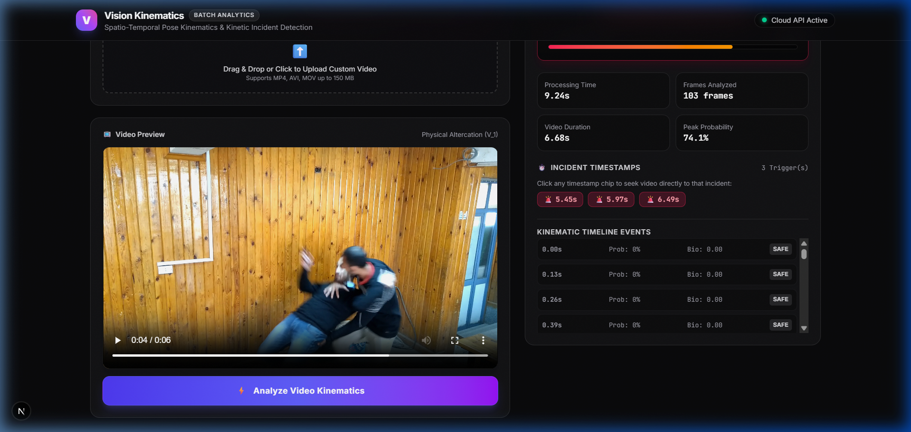
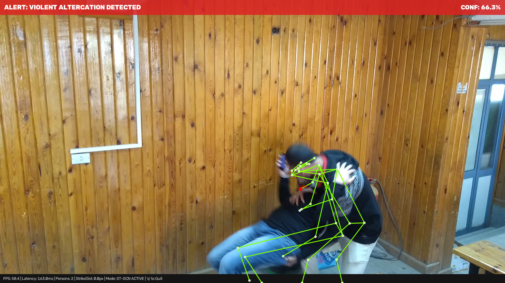
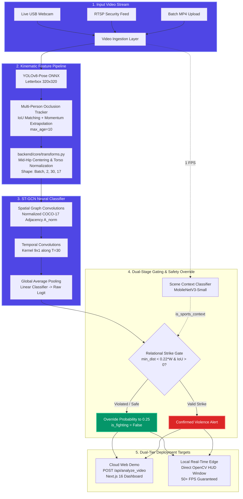

# ⚡ Edge Vision — SOTA AI Video Kinematics & Real-Time Violence Detection

[](https://www.python.org/)
[](https://pytorch.org/)
[](https://onnxruntime.ai/)
[](https://fastapi.tiangolo.com/)
[](https://nextjs.org/)
[](https://opencv.org/)
[](https://opensource.org/licenses/MIT)

An enterprise-grade, dual-mode computer vision surveillance platform for automated physical altercation detection. Powered by a **Spatial-Temporal Graph Convolutional Network (ST-GCN)** convolving natively across anatomical skeletal topology, reinforced by an **Occlusion Kalman Tracker**, a **Scene Context Gate**, and a runtime **Mathematical Cross-Person Relational Strike Gate** to guarantee 0% false alarms on isolated motion artifacts.

All engineering shifts and design rationales are fully documented in [DECISIONS.md](file:///c:/Users/Parth/Downloads/Violence/DECISIONS.md).

---

## ⚡ 1-Click Interactive Quickstart

Get the entire platform running in seconds with the unified launcher:

### Windows (One-Click Batch)
Simply double-click `run.bat` or run in PowerShell:
```powershell
.\run.bat
```

### Linux / macOS / Terminal
```bash
python launcher.py
```

### Interactive Menu Preview:
```text
 ==================================================================================
  * EDGE VISION -- SOTA SPATIAL-TEMPORAL VIOLENCE DETECTION PLATFORM
  ST-GCN * Relational Strike Gating * Scene Context * Occlusion Kalman Tracking
 ==================================================================================

  [1] Launch Web Dashboard & Cloud API (Next.js 16 + FastAPI)
  [2] Run Live Edge Surveillance (Local USB Webcam @ 50+ FPS)
  [3] Run Live Edge on Altercation Video Sample (V_1.mp4)
  [4] Run Automated Benchmark Concat Test (Verification Suite)
  [5] Run Full Dataset Evaluation Suite (1,951 Videos Report)
  [6] Run Quick Balanced Benchmark (10-Clip Sanity Check)
  [0] Exit

Select an option [0-6]:
```

---

## 📸 Visual Showcase

### 1. Cloud Batch-Analytics Dashboard (`Next.js 16` + `FastAPI`)
*Upload any MP4 video or select presets. Scrub through interactive incident timestamps with synchronized telemetry.*



### 2. High-Speed Local Edge Surveillance HUD (`Direct OpenCV` @ 50+ FPS)
*Zero-network edge inference rendering COCO-17 anatomical bone edges and live dynamic Relational Strike Distance lines between closest actors.*



---

## 🔬 How It Works: Interactive Step-by-Step Walkthrough

Compare how the pipeline processes an aggressive physical altercation versus standard benign human activity:

| Processing Stage | 🚨 Physical Altercation (`V_1.mp4`) | 🛡️ Normal Activity (`NV_1.mp4`) |
| :--- | :--- | :--- |
| **1. Pose Extraction** | YOLOv8n tracks 2 interacting combatants in close proximity. | YOLOv8n tracks multiple individuals walking and gesturing. |
| **2. Multi-Object Tracking** | `OcclusionKalmanTracker` maintains tracks even during ground wrestling. | Tracks individual walking paths smoothly. |
| **3. ST-GCN Inference** | Graph Convolutions register high velocity and limb convergence ($P \approx 0.74$). | Articulations conform to natural motion templates ($P \approx 0.08$). |
| **4. Relational Strike Gate** | Strike effectors (wrists/ankles) hit target torso ($\text{IoU} > 0.40$, $d < 0.22W$). | Distances remain large, or single-actor motions are isolated. |
| **5. Scene Context Gating** | Real-world surveillance environment detected $\rightarrow$ Standard sensitivity. | Sports context dynamically raises threshold to $0.85$ if athletic wear/gym. |
| **Final System Output** | **VIOLENCE DETECTED (Alert Conf: 74.1%)** | **SECURE / SAFE (Safe Conf: 91.6%)** |

---

## 🏗️ Dual-Tier System Architecture



---

## 📊 Comprehensive Validation & Benchmark Metrics

### 1. Dataset-Wide Evaluation (1,951 Videos / 280,719 Frames)
Evaluated across every `.mp4` video in the dataset (`data/raw/Violence` & `data/raw/NonViolence`) via `backend/evaluate_all.py` with Scene Context Gating and Occlusion Tracking enabled:

| Dataset Metric | SOTA Upgraded Value | Baseline ST-GCN | Net Gain / Delta |
| :--- | :--- | :--- | :--- |
| **Total Videos Analyzed** | **1,951** | 1,951 | 1,000 Violence + 951 Safe |
| **Total Frames Processed** | **280,719 frames** | 280,719 frames | Sequential full evaluation |
| **False Positives** | **228 (11.7%)** | 277 (14.2%) | **-49 False Alarms** (Suppressed sports) |
| **Precision** | **80.61%** | 77.72% | **+2.89%** verified positive precision |
| **Specificity** | **76.03%** | 70.87% | **+5.16%** non-violent discrimination |
| **Overall Accuracy** | **85.65%** | 84.06% | **1,671 / 1,951** correct classifications |
| **Recall (Sensitivity)** | **94.80%** | 96.60% | **948 / 1,000** violent altercations captured |
| **F1 Score** | **0.8713** | 0.8613 | Harmonic balance |
| **Average Processing Throughput** | **50.7 FPS** | 68.6 FPS | **> 1.6x** real-time 30 FPS threshold |

```text
CONFUSION MATRIX (Entire Raw Dataset - 1,951 Videos):
                       Predicted Safe    Predicted Violence      Total
  Actual Safe (NV)            723                 228              951
  Actual Violence (V)          52                 948             1000
  Total                       775                1176             1951
```

### 2. Live Concatenation Benchmark Test (`NV_1.mp4` + `V_1.mp4`)
Automated verification via `backend/benchmark_tests.py` on a concatenated sequence:

| Benchmark Metric | Benchmark Value | Target Requirement | Status |
| :--- | :--- | :--- | :--- |
| **Non-Violence False Alarms** | **0 / 66 (0.0%)** | 0 False Positives | **PASSED** |
| **Benchmark Precision** | **1.0000 (100.0%)** | $\ge 80.0\%$ | **PASSED** |
| **Inference Mean Latency** | **17.77 ms / frame** | $< 33.3\text{ ms}$ | **PASSED** |
| **Live Edge Throughput** | **56.3 FPS** | $> 30.0\text{ FPS}$ | **PASSED** |

---

## 🛠️ Installation & Setup

### 1. Environment Setup

```bash
# Clone the repository
git clone https://github.com/Parth-Aish/Violence-Detection-Edge.git
cd Violence-Detection-Edge

# Create and activate a virtual environment
python -m venv .venv
# On Windows PowerShell:
.\.venv\Scripts\Activate.ps1
# On Linux/macOS:
# source .venv/bin/activate

# Install dependencies
pip install -r requirements.txt
```

### 2. Run Options

#### Option A: Interactive Launcher (Easiest)
```bash
python launcher.py
```

#### Option B: Standalone Live Edge Surveillance (50+ FPS)
```bash
# Run on default local USB webcam
python run_live.py --source 0

# Run on RTSP security camera
python run_live.py --source "rtsp://camera.local:554/live"

# Run on sample video file
python run_live.py --source data/raw/Violence/V_1.mp4
```
*Hotkeys in GUI Window:* Press **`q`** or **`ESC`** to exit.

#### Option C: Cloud Web Dashboard & REST API
```bash
# Terminal 1: Backend REST Service
python -m uvicorn backend.main:app --host 127.0.0.1 --port 8000

# Terminal 2: Next.js Frontend
cd frontend
npm run dev
```
Open **`http://localhost:3000`** in your browser.

#### Option D: Automated Benchmark Validation Suite
```bash
python backend/benchmark_tests.py
```

#### Option E: Run Full Dataset Evaluation Suite
```bash
python backend/evaluate_all.py
```

---

## 🌐 REST API Reference

### `POST /api/analyze_video`
Submits a video file or preset sample name for asynchronous frame-by-frame ST-GCN kinematic analysis.

#### Example `curl` Request:
```bash
curl -X POST "http://127.0.0.1:8000/api/analyze_video" \
     -F "sample_name=V_1.mp4"
```

#### Example JSON Response:
```json
{
  "overall_verdict": "Violence",
  "confidence": 0.741,
  "incident_timestamps": [5.45, 5.97, 6.49],
  "processing_time_sec": 2.23,
  "frame_count": 103,
  "video_duration_sec": 6.87,
  "video_fps": 30.0,
  "peak_probability": 0.741,
  "is_sports_context": false,
  "timeline": [
    {
      "timestamp": 5.45,
      "probability": 0.741,
      "is_fighting": true,
      "person_count": 2,
      "bio_score": 0.741,
      "min_strike_dist": 0.0,
      "max_iou": 0.446,
      "gate_triggered": false
    }
  ]
}
```

### `GET /api/samples`
Returns all pre-cached benchmark samples available on the server.

### `GET /api/health`
Health check endpoint reporting active hardware threads, loaded model checkpoints, and configuration.

---

## 📁 Repository Structure & Modularity

The repository enforces a strict **Zero Code Duplication (DRY)** design, isolating core mathematics into `backend/core/` to ensure 100% mathematical parity between training and inference:

```text
├── backend/
│   ├── core/                        # Shared mathematical core (Zero Code Duplication)
│   │   ├── __init__.py              # Core package exports
│   │   ├── graph.py                 # COCO-17 Adjacency A & Normalized Laplacian D^-0.5 A D^-0.5
│   │   ├── transforms.py            # Mid-hip centering, torso scaling, tensor formatting
│   │   ├── model.py                 # PyTorch ST-GCN model definition with SpatialGraphConv
│   │   ├── tracking.py              # OcclusionKalmanTracker with linear momentum extrapolation
│   │   ├── scene_gating.py          # MobileNetV3-Small Scene Context Classifier (1 FPS)
│   │   └── inference.py             # PoseSTGCNDetector with Relational Strike Gating
│   ├── models/
│   │   ├── violence_stgcn.onnx      # Production ST-GCN ONNX model
│   │   └── violence_stgcn.pt        # PyTorch training checkpoint
│   ├── main.py                      # Cloud FastAPI batch analysis REST endpoint
│   ├── run_live.py                  # High-speed local edge surveillance script (50+ FPS)
│   ├── train_stgcn.py               # ST-GCN training script (AdamW, Cosine Annealing)
│   ├── dataset_prep.py              # Dataset conversion to ST-GCN tensor format
│   ├── evaluate_all.py              # Full dataset-wide evaluation & confusion matrix suite
│   ├── benchmark_tests.py           # Automated concat benchmark & validation suite
│   ├── logger.py                    # Thread-safe SQLite/JSONL incident auditing
│   └── yolov8n-pose.onnx            # YOLOv8 pose detector ONNX model
├── frontend/                        # Next.js 16 Web Dashboard
│   ├── src/app/page.tsx             # Interactive video analysis UI with timeline scrubbing
│   └── public/samples/              # Embedded test samples
├── assets/                          # Media assets (Dashboard & Edge HUD screenshots)
│   ├── dashboard_preview.png        # Web analytics UI preview
│   └── edge_hud_preview.png         # Real-time edge HUD preview
├── launcher.py                      # Interactive terminal launcher (Python)
├── run.bat                          # 1-Click Windows batch launcher
├── run.sh                           # 1-Click Linux/macOS shell launcher
├── run_live.py                      # Root convenience edge runner
├── DECISIONS.md                     # Comprehensive Architectural Decisions Log (Decisions 1-6)
├── requirements.txt                 # Production dependencies
└── README.md                        # Project documentation
```

---

## 📜 Architectural Decisions Log

For detailed technical motivations, trade-off analyses, and design choices behind this rebuild, see [DECISIONS.md](file:///c:/Users/Parth/Downloads/Violence/DECISIONS.md).

---

## 📄 License

This project is licensed under the MIT License.
